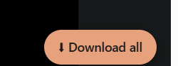
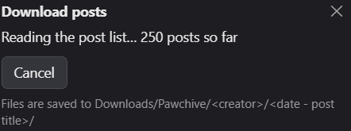
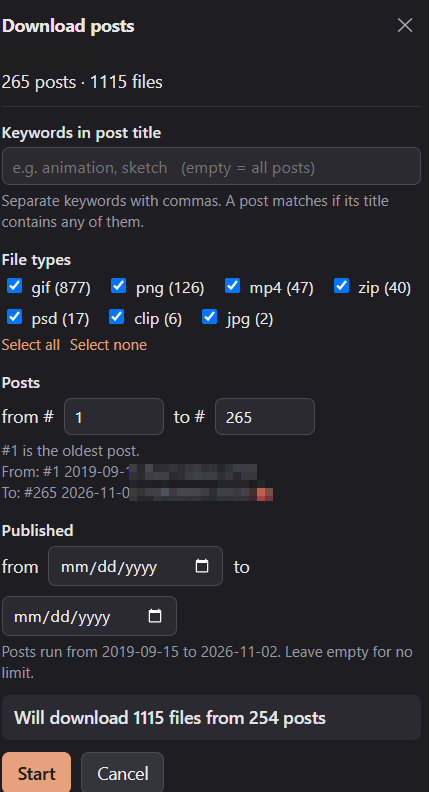

<p align="center">
  
</p>

<h1 align="center">Pawchive Creator Downloader</h1>

<p align="center">
  A Chrome extension that adds a <b>Download all</b> button to <a href="https://pawchive.pw">Pawchive</a> creator pages
  and saves every file from every post into tidy folders.
</p>

---

## What it does

- **Adds a "⬇ Download all" button** to a creator's page, in the bottom-right corner. It doesn't appear anywhere else.
- **Shows you the total first**, for example *"265 posts · 1115 files"*, before anything downloads.
- **Lets you pick exactly what to download** (see [Filters](#filters) below): keywords in the post title,
  file types, a range of posts, and a range of publish dates.
- **Goes post by post** and saves every image, video and attachment, 3 files at a time, with a short pause between files so the site isn't hammered.
- **Keeps things organized:**
  ```
  Downloads/
    Pawchive/
      <creator name> (<service>)/
        <post date> - <post title> [<post id>]/
          01 - cover.jpeg
          02 - <attachment>.png
  ```
- **Pause, resume or cancel** at any time. If you stop, open the panel again later and it skips everything it already saved.
- **Retry failed** re-attempts only the files that didn't download.
- No tracking and no data collection. It only talks to Pawchive.

External links inside posts (MEGA, Google Drive and so on) aren't downloaded. Only files hosted on Pawchive are.

## Download

Click the green **Code** button at the top of this page → **Download ZIP**, then right-click the zip → **Extract All** → **Extract**.
Inside you'll find a folder named `extension`. That's the folder you'll use below.

Keep it somewhere permanent, like `Documents`. Chrome loads it from there, so don't delete it afterwards.

## Install on Chrome

1. Open the menu (⋮) in the top-right corner.

   

2. Go to **Extensions → Manage Extensions**, or type `chrome://extensions` in the address bar.

   

3. Turn on **Developer mode** (toggle in the top-right).

   

4. Click **Load unpacked**.

   

5. Select the `extension` folder.

   

   > ⚠️ **Getting *"Manifest file is missing or unreadable"*?** You selected the wrong folder.
   > Windows often puts the files inside an extra folder when you extract them, so keep opening folders
   > until you see the one named **`extension`**, then select that one.

6. Refresh any open Pawchive tabs and you're done.

Chrome will say the extension can **"Manage your downloads"**. That's needed to save files into folders.

> If Chrome asks where to save **every** file, turn off **Settings → Downloads → Ask where to save each file before downloading**.

## How to use it

1. Open a creator's page on Pawchive and click **⬇ Download all** in the bottom-right corner.

   

2. Wait a few seconds while it reads the creator's post list.

   

3. Narrow it down with the filters if you want. The panel updates live, for example *"Will download 1115 files from 254 posts"*.
   Then click **Start**.

   

Big creators can mean thousands of files and many gigabytes, so make sure you have the space.

### Filters

All filters work together. A post has to match every filter you set.

| Filter | What it does |
| --- | --- |
| **Keywords in post title** | Only posts whose title contains one of the keywords. Separate keywords with commas, e.g. `animation, sketch`. Not case-sensitive. Leave empty for all posts. |
| **File types** | Tick the types you want. The list only shows types the creator actually posted, with how many of each, e.g. `gif (877)`, `png (126)`. `jpg` and `jpeg` count as one type. |
| **Posts from # to #** | A range of posts by number. **#1 is the creator's oldest post.** The panel shows the date and title of the first and last post in your range, so you can check it's the one you want. |
| **Published from / to** | Only posts published between those dates. Leave either side empty for no limit. |

### File names

- Every post gets its own folder ending in its post id, e.g. `[12345678]`, so posts with the same title never mix.
- Every file starts with its number in the post (`01 - `, `02 - `…), so two files with the same name in one post don't overwrite each other.
- Characters Windows doesn't allow (`: ? " < > | * / \`) are replaced with `_`, and very long titles or file names are shortened while keeping the post id and the file extension.

## Disclaimer

This is an unofficial extension. It isn't affiliated with Pawchive or any of the creator platforms it archives.
